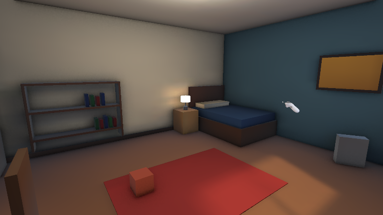
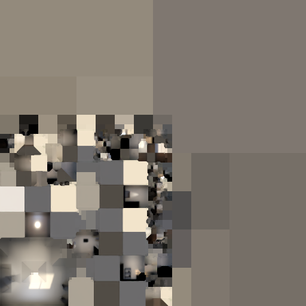
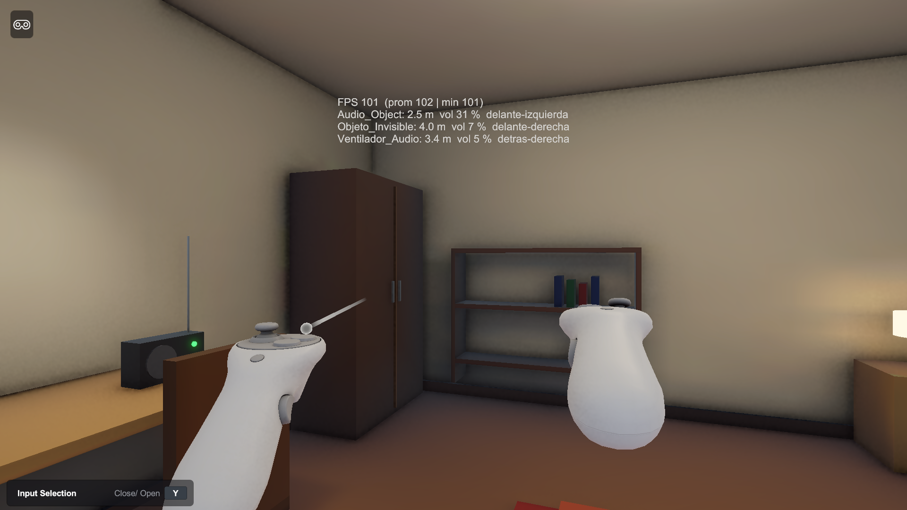

# Práctica 05: XR Inmersión (Unity 6 + XR)

Escena de **realidad virtual** con **iluminación pre-calculada (lightmapping)** y **audio espacial (HRTF)**. Se prueba en PC con el simulador de XR Interaction Toolkit y no necesita visor.

Laboratorio de Realidad Extendida (XR) para Videojuegos, Guía de Práctica N.° 5.

📄 **Reporte (PDF):** [Reportes/Reporte_Practica5.pdf](Reportes/Reporte_Practica5.pdf)



## Resultados

| Dato | Valor |
|---|---|
| Tiempo de bake | **00:00:29** (Progressive GPU, caché de GI borrada) |
| FPS en Play Mode | **104,2 promedio** · mediana 111,6 (PC con el simulador XR) |
| Tipo de luz | **Baked** (Directional, Area, Point y Spot) |
| Audio 3D | **Spatial Blend 1.0 + Logarithmic Rolloff** (Min 1 m / Max 15 m) con Meta XR Audio (HRTF) |

| Lightmap generado | Prueba en Play con el simulador |
|---|---|
|  |  |

## Tecnologías
- Unity **6000.3.10f1** · URP 17.3
- XR Interaction Toolkit **3.6.1**: Starter Assets, XR Interaction Simulator y XR Device Simulator
- OpenXR 1.18 (listo para Meta Quest)
- Meta XR Audio SDK 85: spatializer HRTF y sala acústica

## Cómo probarlo
1. Abre el proyecto con Unity 6000.3.10f1.
2. Abre `Assets/Scenes/Practica05.unity` y pulsa **Play**.
3. Controles del simulador:
   - **WASD:** moverse. **Clic derecho + ratón:** girar la cabeza.
   - **Tab:** cambiar entre cabeza y mandos. **G:** agarrar. **T:** gatillo (enciende o apaga la radio).
   - **V:** ocultar o mostrar `Audio_Object` para localizarlo solo por el sonido.
   - **H:** mostrar u ocultar el HUD de FPS, distancia, volumen y dirección del audio.
4. Usa audífonos para percibir la dirección del sonido.

## Contenido de la escena
- **Arquitectura Static:** `Floor`, `Wall_North`, `Wall_South`, `Wall_East`, `Wall_West`, techo y muebles.
- **Luces Baked:** con Lightmap Parameters para móviles (`LP_Movil_Quest`), Light Probes y Reflection Probe.
- **`Audio_Object`:** radio que se puede agarrar, con audio 3D logarítmico.
- **`Objeto_Invisible`:** solo se encuentra por el sonido. Se revela al acercarse y luego cambia de escondite.
- **`Cube_Interactuable`:** cubo dinámico que se puede agarrar.
- **Post-procesado apto para XR:** Bloom suave, Tonemapping y Color Adjustments, sin efectos que mareen.

## Reproducir la escena
El menú **Practica5** del editor permite:
- **Construir Escena:** genera toda la escena.
- **Bakear Iluminacion:** lanza el bake y registra el tiempo en `Reportes/bake_report.txt`.
- **Exportar Lightmaps a PNG.**

## Estructura
```
Assets/Scenes/Practica05.unity     Escena principal
Assets/Practica5/Scripts           HUD de rendimiento, radio, objeto invisible, visibilidad y hápticos
Assets/Practica5/Editor            Constructor de escena y registro de bakes
Assets/Practica5/Audio             Clips de audio
Reportes/                          PDF, capturas, lightmap, tiempos de bake y FPS
```
